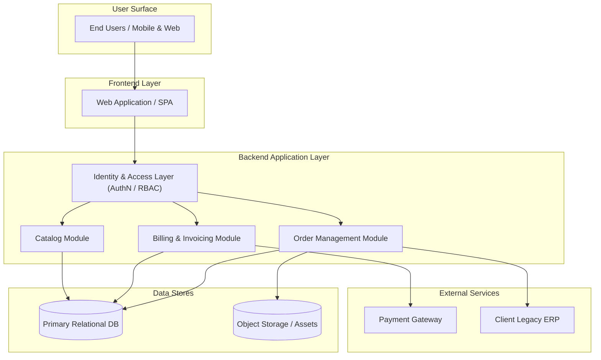

# High-Level Design (HLD) Document Template

Canonical section order and skeleton for architecture deliverables handed to reviewers.

---

## 1. Revision Note

> *Guidance: Document header records version, date, and specific reviewer comments that prompted revisions.*

| Version | Date | Author / Party | Review Comments Addressed |
| :--- | :--- | :--- | :--- |
| v1.1 | 2026-11-09 | Vendor Architecture Team | Addressed EM feedback: simplified HLD topology to 12 boxes, unified Identity layer, moved resolved DB question to Decisions, fixed Word table borders. |
| v1.0 | 2026-11-01 | Vendor Architecture Team | Initial release for delivery manager and client PO review. |

---

## 2. Intent

> *Guidance: State target business outcomes, explicit non-goals, and boundary anti-goals.*

### Goals
- Functional Goal 1: Describe measurable business capability delivered by this architecture.
- Functional Goal 2: Describe system integration or throughput requirement.

### Non-Goals
- Items deliberately out of scope for this phase or release.

### Anti-Goals
- Architectures, features, or operational modes the system explicitly avoids becoming (e.g., "The system is not an ad-hoc reporting warehouse").

---

## 3. Decisions

> *Guidance: Record accepted decisions; "Made by" uses ONLY declared parties (Vendor, Client technical team, Client product owner team).*

| Decision | Made by | Date | Evidence / Rationale |
| :--- | :--- | :--- | :--- |
| PostgreSQL 16 on AWS RDS for primary storage | Client technical team | 2026-11-04 | Verified compatibility with existing client VPC and compliance mandates; discussed in 2026-11-04 architecture sync. |
| Staging-first batch ETL pipeline (Option 2) | Vendor | 2026-11-05 | Eliminates partial write corruptions in reporting tables; benchmarked 3x throughput improvement over direct upsert. |

---

## 4. What Changes vs the Previous Option

> *Guidance: Highlight exact delta, component changes, and trade-offs compared to prior approved architecture or prototype.*

- **Component Additions**: New staging table and batch loader service replace real-time streaming endpoint.
- **Removed Components**: Eliminated dedicated Redis cache; direct RDS read replicas suffice for 500 QPS target.
- **Risk Delta**: Lower operational complexity; increases pipeline recovery SLA from 15 minutes to 1 hour.

---

## 5. High-Level Design (HLD) & Component Topology

> *Guidance: One top-to-bottom diagram (users -> frontend -> backend with single identity layer -> external services <= 15 boxes).*



### Screen / Feature to Module Mapping

> *Guidance: Map every screen or feature to exactly one capability module (1:1 mapping; no catch-alls).*

| Screen / Feature | Capability Module | Description |
| :--- | :--- | :--- |
| `/orders/checkout` | Order Management Module | Order creation, validation, and workflow state transition. |
| `/billing/invoices` | Billing & Invoicing Module | Invoice generation, payment receipt, and reconciliation. |
| `/catalog/browse` | Catalog Module | Product search, inventory listing, and categories. |

---

## 6. Data / ETL Design with Options

> *Guidance: Draw each option with uniform shape (sources -> job -> staging -> store), recommended first, plus evidence list.*

### Option A: Staging-First Batch Ingestion (Recommended)

```mermaid
flowchart LR
  SRC[Source Systems (ERP / CRM)] -->|Extract Delta| JOB[ETL Worker Job]
  JOB -->|Write Parquet| STG[S3 Staging Bucket]
  STG -->|COPY Command| STORE[(Analytical Warehouse)]
```

- **Overview**: Scheduled worker pulls hourly changes, stages immutable Parquet files in S3, and bulk loads into the analytical store.
- **Pros**: Idempotent retries, zero locks on active operational tables, trivial point-in-time recovery.
- **Cons**: Up to 60-minute data latency.

### Option B: Direct Upsert CDC Pipeline (Fallback 1)

```mermaid
flowchart LR
  SRC[Source Systems (ERP / CRM)] -->|WAL / Debezium| JOB[Kafka Stream Job]
  JOB -->|Buffer Micro-batch| STG[Redis Buffer]
  STG -->|Upsert Query| STORE[(Analytical Warehouse)]
```

- **Overview**: Real-time change data capture through streaming buffer into store.
- **Fallback Rationale**: Higher operational burden and failure blast radius; select only if business mandates <5-minute freshness.

### Options Comparison Table

| Evaluation Criterion | Option A: Staging Batch (Recommended) | Option B: CDC Stream (Fallback) |
| :--- | :--- | :--- |
| Data Freshness | 60 minutes | < 5 minutes |
| Operational Complexity | Low (Serverless / S3 / SQL) | High (Kafka cluster + Debezium connectors) |
| Failure Blast Radius | Bounded to single hourly batch | Stream backlog / consumer lag alerts |
| Recovery Mechanism | Re-run batch from immutable staging | Replay offset with potential duplicate reconciliation |
| Infrastructure Cost | ~$250 / month | ~$1,400 / month |

### Evidence: Verified in Repo vs Assumed

- **Verified in Repo**: Database schema exists under `migrations/20261101_init.sql`; S3 client credentials configured via IAM role in Terraform.
- **Assumed**: ERP export API supports `modified_since` timestamp filtering (pending client confirmation).

---

## 7. Identity & Access Management (RBAC)

> *Guidance: Single cross-cutting identity/access layer drawn once in front of all modules, not duplicated per service.*

- **Authentication**: JWT validation via centralized Identity & Access layer at API Gateway.
- **Role-Based Access Control (RBAC)**: Fine-grained permissions evaluated before request enters business modules:
  - `Admin`: Full read/write across all modules.
  - `Manager`: Read/write within assigned organization branch.
  - `Operator`: Read-only access to operational orders and reports.

---

## 8. Key Flows

> *Guidance: Detail sequence or dataflow for the critical user or operational journeys.*

### Flow 1: Order Placement & Inventory Allocation

1. User submits checkout form on Frontend.
2. Identity layer validates JWT bearer token and user role.
3. Order Management Module reserves inventory atomically.
4. Billing Module executes payment authorization against Payment Gateway.
5. Order state transitions to `CONFIRMED` and event emitted to external ERP.

---

## 9. Non-Functional Requirements (NFRs)

> *Guidance: State performance, availability, security, and explicitly clarify configuration files vs admin UI.*

- **Throughput & Latency**: p95 API response <= 250ms at 300 QPS peak load.
- **Availability**: 99.9% uptime (<= 43.8 minutes downtime per month).
- **Configuration vs Admin UI**:
  - **Configuration Files**: Application feature flags, retry timeouts, and cron schedules are hardcoded YAML config files versioned in git and deployed via CI/CD.
  - **Admin Screens**: User account provisioning, organization tenant setup, and manual transaction overrides are managed via dedicated Admin UI screens.

---

## 10. Prerequisites from Client

> *Guidance: List required access, credentials, environments, or sample datasets owed by client technical team.*

| Prerequisite | Responsible Party | Needed By | Impact if Delayed |
| :--- | :--- | :--- | :--- |
| VPN access and staging ERP API credentials | Client technical team | 2026-11-15 | Blocks ETL ingestion end-to-end integration tests. |
| Production domain TLS certificate | Client technical team | 2026-11-22 | Blocks UAT environment cutover. |

---

## 11. Risks & Mitigations

> *Guidance: Enumerate known technical or delivery risks with probability, impact, and concrete mitigations.*

| Risk | Probability | Impact | Mitigation Strategy |
| :--- | :--- | :--- | :--- |
| ERP export payload schema changes unexpectedly | Medium | High | Schema validation on ingestion with dead-letter queue and Slack notification. |
| Client VPN tunnel drops during batch execution | Low | Medium | Automatic exponential retry with idempotent resumption from staging checkpoint. |

---

## 12. Sign-Offs

> *Guidance: Keeps ONLY pending approvals as "Agree that..." rows for named approvers; ZERO open questions.*

| Agreement Item | Approver (Named Party) | Status | Date |
| :--- | :--- | :--- | :--- |
| Agree that 60-minute batch latency meets business reporting needs (Option A). | Client product owner team (Jane Doe) | Pending | |
| Agree that Vendor manages configuration via git deployments without client-facing admin screen. | Client technical team (John Smith) | Pending | |
| Agree that data retention in primary DB is 24 months before cold archive to S3. | Client technical team (John Smith) | Approved | 2026-11-06 |

---

## 13. Left to the Builder

> *Guidance: Explicitly scope internal implementation choices delegated to engineering discretion.*

- Internal code package structure, class naming, and unit test framework selection.
- Database connection pool sizing (e.g., HikariCP min/max idle parameters).
- Specific logging format and trace ID propagation middleware implementation.
