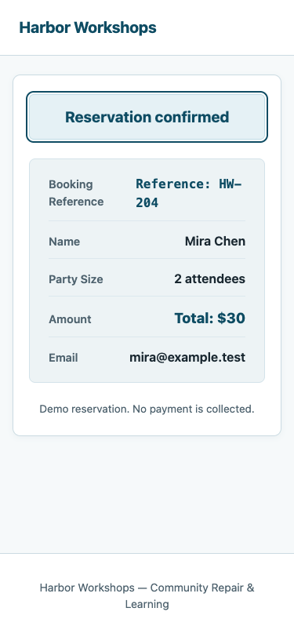
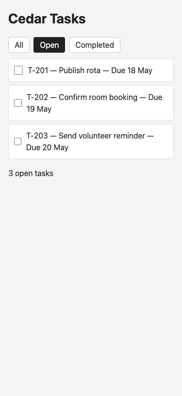
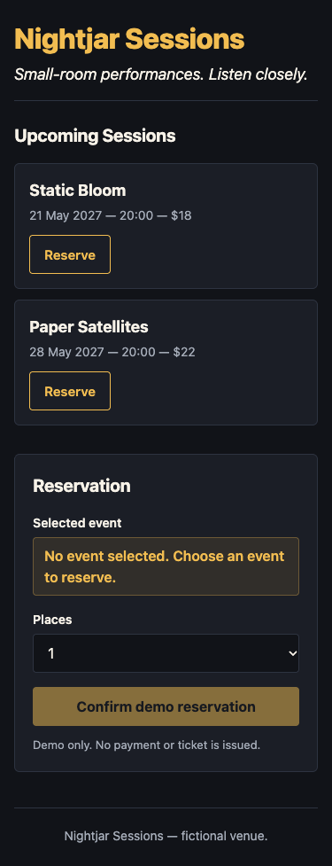

# UI Quality Benchmark — Fixture Verification Report

**Scope**: Six synthetic fixtures: reference implementations B1–B4 and identical future-arm starters B5/B6 under `benchmarks/ui-quality/fixtures/`.
**Status**: Fixtures verified and frozen; experiment PAUSED by operator.
**Boundary Notice**: These fixture implementations are deterministic reference benchmarks and starter materials, NOT experimental model outputs. They do not demonstrate model quality improvements, cross-provider portability, or full WCAG conformance.

---

## 1. Primary Chromium Smoke Verification

- **Driver**: `playwright-cli` 0.1.8
- **Browser Runtime**: Chromium 156.0.8078.4
- **Tested Viewports**:
  - Desktop: 1440×900
  - Tablet: 768×1024
  - Mobile: 375×812
- **Observed Results**:
  - **Desktop / Mobile task, layout, and retry checks**: 25 / 25 PASS
  - **Focus, reduced motion, and heading semantics checks**: 5 / 5 PASS
  - **Tablet document-bounds checks**: 6 / 6 PASS
  - **Total checks**: 36 / 36 PASS
  - **Page JS Errors**: 0 observed (an initial favicon 404 was a static server asset miss, not an application JS error)
- **Baseline Failure and Correction**:
  - Initial browser run resulted in 23 passed, 2 failed: unchecking B5 in the Completed filter timed out at desktop and mobile sizes. Separate source and keyboard checks identified focus-retention defects.
  - Source corrections were made to B5 keyboard handling and focus retention.
  - Independent source reviewer `c387479c-421b-4164-ab6e-a76846bd51a2` reviewed and closed all 4 original source findings (B5 focus retention/fallback, B3 confirmation focus, B2/B3 reduced motion, B6 h1 structure) with no reopened findings. (Reviewer did not independently rerun browser execution).
  - Final re-run with cache-busting revision query parameters confirmed 36 / 36 checks passing without stale DOM interference.

---

## 2. Isolated Tooling (WebKit & Axe) Verification

- **Isolated Tooling Environment**: Local untracked environment under `.playwright-cli/ui-quality-fixtures/tooling/` (Playwright 1.64.1, WebKit 27.2, axe-playwright 4.14.0).
- **Initial Mobile State Load**: All 6 fixtures loaded at 375×812 in WebKit 27.2; no independent WebKit page-error collection was performed.
- **Axe Automated Audit**: 0 automated violations reported across all 6 initial mobile states.
  - Incomplete checks requiring manual review: B2 Relay Dispatch (`color-contrast`) and B6 Nightjar Sessions (`aria-prohibited-attr`).
- **WebKit B5 Keyboard Verification**: Native Space-toggle, focus retention, and Completed filter toggle to empty with fallback focus: PASS.

---

## 3. Explicit Unverified Lanes & Proof Limits

The following areas are explicitly **unverified** and were NOT RUN in this verification phase:
- **Screen-reader announcements**: No screen-reader execution (e.g. VoiceOver/NVDA) was conducted.
- **200% Zoom Flow**: No 200% zoom text-scaling or reflow verification was performed.
- **Full Contrast Audit**: Dynamic state contrast across all interactive states remains unverified (B2 color-contrast incomplete check pending manual review).
- **Full-State WebKit Flows**: Interactive multi-step task flows across all dynamic states were not executed in WebKit (only initial mobile states and B5 keyboard were verified in WebKit).
- **No Empirical Generations**: No experimental candidate/baseline generation calls were run; preparation used implementation agents, but no paired evaluation outputs exist.
- **No Blanket WCAG Conformance**: Automated axe scans and focused keyboard checks do not establish full WCAG 2.1/2.2 AA conformance.

---

## 4. Visual Evidence Artifacts

Representative mobile (375×812) task captures demonstrating interactive states:

- **B3 — Harbor Workshops (Confirmation State)**:
  `evidence/b3-375-task.png`
  

- **B5 — Cedar Tasks (Open Tasks After Completed-to-Empty Recovery)**:
  `evidence/b5-375-task.png`
  

- **B6 — Nightjar Sessions (Initial Editorial Presentation)**:
  `evidence/b6-375-initial.png`
  

*Note: Raw local runner configurations, session caches, and raw screenshot dumps under `.playwright-cli/` are local untracked evidence and are excluded from the public PR.*

---

## 5. Experiment Status

The evaluation experiment is **PAUSED BY OPERATOR**. All synthetic reference fixtures and starters are frozen in `fixtures-freeze.json`. Execution gates (pinned models across multiple providers, calibrated independent reviewers, host authorization, and finite resource ceilings) remain prerequisites before any experimental runs may be scheduled.
