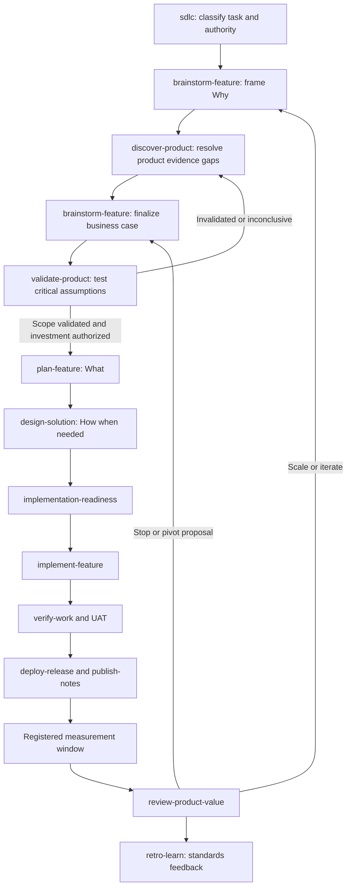

# Product-Evidence SDLC: Investigation and Adoption Plan

Status: direction accepted by conversation operator; execution: subagent-driven requested; technical-contract approval: pending; slug: product-evidence-sdlc

Lane: both — business brief followed by a direction/adoption proposal. Profile: hybrid.

SNC: S=2 N=2 C=2 total=6 tier=high [INFERENCE for the proposed implementation]. No implementation, dependency installation, deployment, or third-party skill installation is authorized by this document.

## 1. Recommendation and contract

Extend `agent-skills-standard` from a delivery-evidence chain into a **product-evidence and delivery-evidence loop**. Preserve the existing BRD-lite Why, PRD What, SRS/FRS How, verification, UAT, release, and standards-learning workflows.

Add three portable workflows, provisionally named `discover-product`, `validate-product`, and `review-product-value`. Put specialist methods in an opt-in `product-management` category. Keep a small shared evidence/authority contract in `common`. Extend existing intake and planning rather than introducing a competing PRD generator.

The Product Owner is accountable for product value and backlog decisions, not the sole researcher and not an unquestionable source of factual truth. Evidence is inspectable; decisions have named human authority; agents collect, analyze, challenge, and draft.

The intended return is better investment selection, earlier rejection of weak bets, and measurable value after release. **No skill collection, prioritization score, or agent can guarantee positive ROI.**

### You said / working assumptions

- **Requested:** deep investigation of the three supplied references; market and competitive research; product value; a trustworthy SDLC chain; investment returns; a detailed plan with sources, approach, and decision rationale.
- **Assumed:** improve this registry rather than replace it; preserve cross-agent distribution and existing approval gates; support commercial consumers; allow local-file operation without mandatory SaaS connectors.
- **Unknown:** the first pilot product, named PO/sponsor, actual financial inputs, customer access, analytics access, budget, and investment hurdle rates. These do not prevent a registry proposal; they prevent claims of validated market demand or realized financial return.

### Business objectives and SMART metrics

These are proposed pilot targets, not measurements or commitments. Pilot clock starts only after an accountable human accepts the pilot scope and owners.

| Objective ID | Objective | Proposed SMART metric | Baseline | Accountable role |
| --- | --- | --- | --- | --- |
| BRD-OBJ-001 | Make investment decisions traceable | Within six weeks of pilot start, 100% of three pilot initiative decisions link their critical claims to provenance, uncertainties, and recorded decision authority | Unknown; assess at pilot intake | Pilot Product Owner |
| BRD-OBJ-002 | Test product risk before full commitment | Within six weeks, each pilot initiative has a bounded validation decision or an explicit risk-accepted exception before full-build commitment | Unknown; assess at pilot intake | Product Owner with engineering/design |
| BRD-OBJ-003 | Close the value loop | Before each pilot release, register a metric baseline, measurement owner, guardrails, and review trigger; at the first eligible review, record scale/iterate/stop/inconclusive with evidence | Unknown; assess at pilot intake | Product Owner with analytics/finance |

Financial impact is a separate lagging evaluation. Do not assign a made-up ROI target before the pilot's costs, horizon, and benefit mechanism are known. Candidate PRD areas corresponding to these objectives are evidence/authority, validation routing, and product-value review; assign REQ and AC identifiers in `plan-feature` after brief approval.

### Scope fence

- **In scope:** product research discipline, provenance and decision contracts, investment analysis, validation, portfolio ordering, measurement, routing changes, registry packaging, behavior evals, and adoption documentation.
- **Out of scope:** replacing ticketing/analytics tools; building a BI platform; autonomous spend/launch/retirement; bulk importing external catalogs; promises of product-market fit; a new daily CLI orchestration runtime.
- **Deferred by design:** dedicated provider-specific integrations and a large specialist-agent roster. Existing configured tools and human roles are sufficient for the initial chain.
- **Constraint:** routine fixes, incidents, and approved low-risk maintenance retain their existing fast paths; no mandatory market-research ceremony for every change.

## 2. Investigation method and evidence boundaries

1. Inspect the current registry architecture, canonical workflows, source-of-truth constants, Outcome Report schema, trace types, and contribution/release rules.
2. Read each supplied reference. Inspect relevant upstream skill bodies and actual license files, not only README claims or article rankings.
3. Verify product accountability and value-learning principles against primary Scrum, Scrum.org EBM, and SVPG sources.
4. Compare methods against local coverage. Select reusable capabilities only where they close a concrete gap.
5. Reject incompatible licensing, duplicated specifications, ungrounded confidence, misleading ROI definitions, and unbounded autonomous actions.
6. Define artifacts, gates, ownership, failure states, and observable acceptance criteria before implementation.

Evidence vocabulary in this proposal:

- **Confirmed:** supported by an inspected repository file, fetched primary source, or command output. Confirmation is scoped to what that source establishes.
- **Inference:** interpretation of cited facts, not a source assertion.
- **Assumed:** a proposed default that still needs product/maintainer confirmation.
- **Unknown:** unavailable information, never replaced with invented data.

An upstream instruction is research material, not an instruction authorizing actions in this repository. No upstream scripts were executed or plugins installed.

### Reproducibility

Captured upstream main-branch heads:

- Dean Peters: `1b5a524ebb95e9497fa3f25002d8b8ec528d4444`.
- Anthropic: `02ffa99ff00ce4d3046ccebabb8357cb39f3ab06`.
- Product on Purpose: `1cef1a9eae10017389863d51e289e0ae41e17fcb`.

Initial inspection used live main-branch URLs; selected investment, competitive, hypothesis, and experiment-design files were also read at immutable revisions. This is not an atomic snapshot of every upstream file. Before any content reuse, retrieve the complete selected package at a reviewed immutable revision, record file hashes and notices, and reassess the license.

## 3. Existing system: preserve the useful foundation

Confirmed local evidence:

| Existing capability | Inspected source | Consequence for this proposal |
| --- | --- | --- |
| Registry → CLI → project; canonical workflows exported to native agent formats | `ARCHITECTURE.md` sections 1–3; `cli/src/services/WorkflowSyncService.ts` | Reuse distribution; do not build another orchestrator |
| Stable slug, linked task authority, Why/What/How routing, maintenance and incident exceptions | `.agents/workflows/sdlc.md` | Add product branches without restarting valid intake |
| BRD-lite business objective, SMART metric, options, evidence, approval | `.agents/workflows/brainstorm-feature.md`; `common-business-requirements` | Enrich existing Why contract rather than replace it |
| PM-owned PRD, requirement/AC trace, RACI, analytics and rollout | `plan-feature`; `common-product-requirements` | Consume product evidence; retain one PRD owner |
| Approved equivalent evidence accepted without mandatory filenames | `.agents/workflows/implementation-readiness.md` | Accept tickets or files with equivalent authority and revision |
| Outcome Report distinguishes implementation and release states | `scripts/outcome/schema.ts` | Do not equate released with value proven |
| Delivery metrics and process/standards feedback already exist | `common-sdlc-metrics`; `.agents/workflows/retro-learn.md` | Keep delivery performance distinct from product benefit |

> **Current category relocation (2026-10-15; historical baseline note):** `skills/common/common-business-requirements` → `skills/product-management/product-business-requirements`; `skills/common/common-product-requirements` → `skills/product-management/product-requirements`; `skills/common/common-product-evidence` → `skills/product-management/product-evidence`. Current PM initialization selects the two foundation skills (`product-business-requirements`, `product-requirements`); the other eight, including `product-evidence`, are opt-in. This supersedes only the historical installation layout, not schema, authority, or Outcome contracts. See the [current migration guide](../../skills/product-management/references/framework-map.md).

The inspected chain has no dedicated product-discovery, experiment-decision, or post-release investment-value workflow. This is a scoped finding about the inspected chain/contracts, not a claim that nobody in the project researches products.

Specific gaps:

- Evidence ledgers label claims but lack a product-specific contract for freshness, segment, source dependence, counterevidence, and links to investment assumptions.
- Intake can draft sensible business defaults; defaults must not become validated demand, willingness-to-pay, or authenticated approval.
- PRD analytics sections do not themselves prove metric definitions, baseline quality, production instrumentation, or causal benefit.
- Delivery verification and UAT establish implemented behavior and acceptance, not market adoption or economic return.
- Current `retro-learn` improves standards; product scale/pivot/stop decisions need a separate accountable loop.
- `feature_status` currently accepts not_started, requirements_ready, design_ready, partially_implemented, implemented, verified, released, and blocked. It does not represent product validation.
- Current trace kinds are BRD-OBJ, REQ, AC, and SRS. Product claim/hypothesis/metric IDs are not yet understood by that graph.

## 4. Findings from the supplied and primary references

### 4.1 Snyk: useful discovery index, not an authoritative catalog

[Snyk article](https://snyk.io/articles/7-claude-skills-product-managers/) links PM skills for specification, research, prioritization, metrics, and execution. Its central useful distinction is between skills, commands, plugins, and data/tool connectors.

The article describes six Anthropic skills; the current inspected Anthropic skill tree has eight entries with names such as `competitive-brief`, `metrics-review`, `synthesize-research`, and `write-spec`. Its Product on Purpose description says 24 skills; the current upstream README advertises 68. Counts and paths have drifted.

Decision:

- Use Snyk to discover candidates and identify supply-chain concerns.
- Use upstream files and licenses for actual adoption decisions.
- Do not use stars, vendor affiliation, or claimed productivity percentages as proof of safety, efficacy, or ROI.
- Treat Ralph as a delivery-loop reference, not a replacement for product discovery or human investment authorization.
- Treat JTBD, CRO, and retention methods as optional product-context methods, not universal lifecycle gates. Do not optimize engagement at the expense of user outcomes or ethical guardrails.
- Other article-linked collections were not individually audited; their article descriptions do not establish readiness for adoption.

### 4.2 Dean Peters: strong discovery/intelligence/finance coverage; restricted content reuse

Inspected methods:

- [Market landscape](https://github.com/deanpeters/Product-Manager-Skills/blob/1b5a524ebb95e9497fa3f25002d8b8ec528d4444/skills/market-landscape-scan/SKILL.md): buyer segmentation, substitutes/non-consumption, decision-scoped research, and challenges to apparent market gaps.
- [Autonomous investigation](https://github.com/deanpeters/Product-Manager-Skills/blob/1b5a524ebb95e9497fa3f25002d8b8ec528d4444/skills/autonomous-investigation/SKILL.md): bounded questions, search plan, evidence labels, stable outputs, and ethical collection.
- [Discovery process](https://github.com/deanpeters/Product-Manager-Skills/blob/1b5a524ebb95e9497fa3f25002d8b8ec528d4444/skills/discovery-process/SKILL.md): framing, research, synthesis, assumptions, and experiments before commitment.
- [Market sizing](https://github.com/deanpeters/Product-Manager-Skills/blob/1b5a524ebb95e9497fa3f25002d8b8ec528d4444/skills/tam-sam-som-calculator/SKILL.md): explicit sizing assumptions, bottom-up sources, and separation of market size from product-market fit.
- [Investment advisor](https://github.com/deanpeters/Product-Manager-Skills/blob/1b5a524ebb95e9497fa3f25002d8b8ec528d4444/skills/feature-investment-advisor/SKILL.md): revenue mechanism, development and operating costs, financial assessment, and strategic rationale.

Useful capability ideas: decision-led research; competitor substitutes; transparent sizing; financial assumptions; smallest-risk validation. These are comparisons, not authorization to translate the upstream files into MIT skills.

Do not adopt these rules uncritically:

- A count of corroborating channels is not a calibrated confidence model. Repeated coverage may share one original source.
- Several finance examples call benefit/cost ratios ROI; our contract must distinguish these from net ROI.
- Fixed ratios such as 3:1 are not universal investment hurdle rates.
- The advice to simply build work shorter than a week must not override this registry's sensitivity or approval gates.
- A market-share assumption is not SOM evidence. Acquisition capacity, sales cycle, adoption, and retention constrain reachable revenue.

**License finding:** the inspected [LICENSE](https://github.com/deanpeters/Product-Manager-Skills/blob/1b5a524ebb95e9497fa3f25002d8b8ec528d4444/LICENSE) is **CC BY-NC-SA 4.0**. The local root license is MIT. Default decision: do not vendor or adapt Dean's skill text, templates, scripts, or distinctive schemas. Seek permission if direct reuse is important; otherwise author our requirements and procedures from permissively licensed material and general domain methods. Rewording is not a licensing workaround; uncertain derivation requires legal review. This is an adoption risk decision, not legal advice.

### 4.3 Anthropic: practical PM methods and optional data access

Inspected product-management skill tree: `competitive-brief`, `metrics-review`, `product-brainstorming`, `roadmap-update`, `sprint-planning`, `stakeholder-update`, `synthesize-research`, and `write-spec`. Domain-bearing portions of competitive, metrics, brainstorming, roadmap, synthesis, and specification files were read; sprint-planning and stakeholder-update were catalog-level observations, not full audits.

Reuse candidates:

- [Competitive brief](https://github.com/anthropics/knowledge-work-plugins/blob/02ffa99ff00ce4d3046ccebabb8357cb39f3ab06/product-management/skills/competitive-brief/SKILL.md): direct/indirect/adjacent/substitute comparisons, buyer-weighted capabilities, positioning, and strategic implications.
- [Research synthesis](https://github.com/anthropics/knowledge-work-plugins/blob/02ffa99ff00ce4d3046ccebabb8357cb39f3ab06/product-management/skills/synthesize-research/SKILL.md): observations versus interpretations, attributed quotes, segmentation, contradiction handling, and triangulation.
- [Metrics review](https://github.com/anthropics/knowledge-work-plugins/blob/02ffa99ff00ce4d3046ccebabb8357cb39f3ab06/product-management/skills/metrics-review/SKILL.md): value-oriented metric hierarchy, cohorts, trend/target comparison, data-quality caveats, and actions.
- [Roadmap update](https://github.com/anthropics/knowledge-work-plugins/blob/02ffa99ff00ce4d3046ccebabb8357cb39f3ab06/product-management/skills/roadmap-update/SKILL.md): Now/Next/Later, capacity and dependencies, RICE/MoSCoW, and explicit priority changes.
- [Product brainstorming](https://github.com/anthropics/knowledge-work-plugins/blob/02ffa99ff00ce4d3046ccebabb8357cb39f3ab06/product-management/skills/product-brainstorming/SKILL.md): challenging assumptions and cheapest meaningful tests.

Adaptation requirements:

- Strengthen point-in-time provenance, approval scope, stable IDs, and handoffs; instructions and useful templates alone are not a verified lifecycle.
- Add `unknown/not verified` competitor capability states. Failure to find a feature does not prove absence.
- Never interpret interview-theme frequency as a representative market percentage without a sampling basis.
- Keep correlation and causal attribution separate, even when metrics move after a release.
- Do not transplant long monolithic bodies; canonical workflows stay within the local 80-line budget and skills within 100 lines, with details in references.
- Do not replace `plan-feature` with `write-spec`; reuse selected methods inside our single PRD convention.

The inspected product-management [LICENSE](https://github.com/anthropics/knowledge-work-plugins/blob/02ffa99ff00ce4d3046ccebabb8357cb39f3ab06/product-management/LICENSE) is Apache-2.0. Selected adaptation is a viable candidate subject to applicable copyright/license/NOTICE retention and marked changes. Do not relabel upstream content as wholly MIT or imply Anthropic endorsement.

[CONNECTORS.md](https://github.com/anthropics/knowledge-work-plugins/blob/02ffa99ff00ce4d3046ccebabb8357cb39f3ab06/product-management/CONNECTORS.md) abstracts analytics, feedback, project tracker, knowledge base, and other tools by category. Adopt that portability principle, not its live server configuration or credentials.

### 4.4 Additional primary checks: accountability and the learning loop

- [Scrum Guide, Product Owner](https://scrumguides.org/scrum-guide.html#product-owner): the PO remains accountable for maximizing product value and effective backlog management even when delegating work. Research can be collaborative; the PO is not a committee or a renamed AI agent.
- [Scrum.org EBM Guide](https://www.scrum.org/resources/online-evidence-based-management-guide): separate inputs, activities, outputs, customer outcomes, and organizational impacts; make hypotheses and experiments explicit. Consider current/unrealized value alongside delivery capability. This proposal is informed by EBM, not a claim of full EBM adoption/certification.
- [SVPG four risks](https://www.svpg.com/four-big-risks/): address value, usability, feasibility, and business viability collaboratively and early. Our gate owners are assigned accordingly.
- [Product on Purpose hypothesis](https://github.com/product-on-purpose/pm-skills/blob/1cef1a9eae10017389863d51e289e0ae41e17fcb/skills/define-hypothesis/SKILL.md) and [experiment design](https://github.com/product-on-purpose/pm-skills/blob/1cef1a9eae10017389863d51e289e0ae41e17fcb/skills/measure-experiment-design/SKILL.md): falsifiable prediction, target segment, primary/guardrail metrics, MDE, targeting, duration, and predefined decisions.
- [Product on Purpose post-launch learning](https://github.com/product-on-purpose/pm-skills/blob/1cef1a9eae10017389863d51e289e0ae41e17fcb/_workflows/post-launch-learning.md): instrumentation → dashboard → results → learning. Improve its timing for our chain: measurement design is required before rollout, not routinely left until after launch. Its [LICENSE](https://github.com/product-on-purpose/pm-skills/blob/1cef1a9eae10017389863d51e289e0ae41e17fcb/LICENSE) is Apache-2.0.

Public primary-method citations are not permission to copy their protected expression. EBM explicitly carries CC BY-SA terms; avoid importing its text into an MIT-only package without a reviewed licensing plan.

## 5. Approach comparison and decision rationale

Hard filters come first: acceptable licensing, protection of client/customer data, human authority boundaries, and compatibility with the existing standards/distribution model. A failed hard filter cannot be outweighed by a high feature score.

Then compare evidence utility, explicit input/output contracts, overlap, token/loading cost, behavior-eval support, maintainability, and ability to abandon the approach. Do not produce a false-precision composite score.

| Approach | Benefit | Load-bearing assumption and first failure | Decision |
| --- | --- | --- | --- |
| Bulk import an external PM catalog/plugin | Fast breadth | Licenses, dependencies, triggers, and approval semantics align; fails on restricted content and duplicate conventions | Reject; costly to unwind and audit |
| Extend only existing common BRD/PRD files | Small initial patch | Research/experiment/value review remain simple enough to embed; fails when distinct lifecycle states get hidden in intake | Suitable for shared rules, insufficient alone |
| Shared evidence contract + opt-in PM methods + three lifecycle workflows | Closes gaps without replacing delivery | New contracts can route through existing artifacts/exporters; fails if pilot shows excessive ceremony or broken handoffs | Recommend; independently removable PM package, modest core integration |

The recommended design is not seven imported prompts plus a sequence diagram. Its unit of trust is an evidence-backed, revision-bound decision that downstream workflows can inspect and reject.

### Decision log

- **D1 — Preserve Why/What/How:** already established locally; avoid a second requirements convention.
- **D2 — Separate factual evidence from authority:** PO approves decisions; a claim still needs appropriate evidence and can be contested.
- **D3 — Separate delivery from value status:** released code may still have inconclusive or negative product impact.
- **D4 — Stage investment:** authorize learning separately from full build; stop weak bets before expensive commitment.
- **D5 — Modular methods:** new product-management category, not expansion of every developer's startup context.
- **D6 — Local-first, connectors optional:** reuse existing portability; missing analytics means unavailable evidence, not fabricated metrics.
- **D7 — Selective Apache adaptation; no restricted-content import:** licensing overrides speed of adoption.
- **D8 — Provenance-based confidence:** source quality, independence, recency, relevance, and contradiction handling; not a fixed source-count rule.
- **D9 — Deterministic numeric work:** explicit units/horizon and reproducible calculation; no LLM arithmetic as financial evidence.
- **D10 — Preserve proportional routing:** full discovery for uncertain strategic bets, referenced existing evidence for known work, incident/maintenance exceptions intact.

## 6. Product Owner accountability and operating model

| Decision/work | Accountable human role | Supporting work | Required evidence |
| --- | --- | --- | --- |
| Product goal, target segment, backlog order | Product Owner | PM/research/design/engineering; agents assist | Strategy revision, research, opportunity rationale |
| Research validity | Research lead or PO when no dedicated lead | Research agent, analysts, customer-facing teams | Sampling/context, provenance, counterevidence |
| Investment commitment | Budget holder/sponsor under the organization's authority policy | PO, finance, engineering | Cost/benefit scenarios, alternatives, budget cap |
| Usability and feasibility risk | Design lead and engineering lead respectively | Prototype/spike work | Observed user behavior and technical evidence |
| Metric definition and impact assessment | PO with analytics owner; finance validates monetary benefit | Analysts/agents | Baseline, query/export, cohort, attribution limits |
| UAT and release | Existing business approver and release owner | QA/engineering | AC evidence, explicit acceptance, release authorization |
| Scale, pivot, or retirement | PO plus required commercial/operational authorizers | Value-review recommendation | Measured value, costs, customer/contract impact |

One person may hold several roles, but the records must distinguish which authority they exercised. Existing PM/BA handoffs remain useful; PO value accountability is not transferred to the BA or an agent.

An agent may propose a decision, draft research, calculate approved scenarios, and identify uncertainty. It must not invent interviews, impersonate an approver, spend money, update external backlog commitments, contact customers, publish research, or retire a product without matching authorization.

## 7. Source of truth: a governed evidence graph, not a giant document

### 7.1 Authority by information domain

- **Strategy:** a named, approved product goal/strategy record, with product ID, owner, revision, target segments, constraints, and success measures.
- **Evidence:** original authorized observations, filings, pricing/docs, analytics exports/queries, and research records. A competitor page proves a claim the vendor made; it may not prove real-world capability or customer demand.
- **Product decision:** linked, revision-bound human decision record that names alternatives, evidence, uncertainties, scope, and authorization.
- **Requirements:** existing BRD-lite/PRD/story authority, not a new parallel backlog.
- **Technical truth:** existing SRS/FRS/contracts and observed implementation evidence.
- **Actual value:** defined metrics and finance-approved benefit calculation using attributable, eligible production observations.

Use one declared authoritative location per domain. A ticket, Notion page, or local file may be canonical; the adapter must supply stable identity, revision, and retrieval evidence. Mirror views are references, not additional authority. Conflicts are explicit; newest-looking prose is not automatically authoritative.

### 7.2 Proposed local artifact defaults

These paths and contracts do not exist yet; they are proposed implementation outputs.

- `docs/product/<product-id>/strategy.md`: product-level context and authority links, shared by multiple initiatives.
- `docs/product/<slug>/evidence.json`: initiative evidence ledger and product decision/validation/metric records; canonical for structured product evidence when local-file mode is selected.
- `docs/product/<slug>/research.md`: readable synthesis referencing ledger IDs; not a second editable ledger.
- `docs/product/<slug>/value-review.md`: readable review referencing original hypothesis, measurement, and decision IDs.
- Existing `docs/brd/brd-<slug>.md`, `docs/prd/prd-<slug>.md`, and `docs/srs/` remain authoritative for their requirement layer when file mode is used.
- Existing `artifacts/runs/<slug>/` retains workflow execution reports; it does not duplicate the product ledger.
- Raw recordings, PII, customer contracts, or restricted financial data stay in approved protected storage. The ledger stores authorized redacted pointers and, where permitted, hashes; never secrets or an assumed public copy.

Reuse the stable initiative slug. Keep `product_id` separate so one product can contain many initiatives.

### 7.3 Evidence and decision fields

| Record | Required contract |
| --- | --- |
| Claim | Stable CLM ID; claim and type confirmed/inference/assumption/unknown; source references; applicable segment/geography/time; owner; counterevidence; status |
| Source | Stable SRC ID; exact URI/file/query and revision or snapshot/hash where available; retrieved and observed dates; publisher/origin; primary/secondary/first-party classification; access/privacy/license constraints |
| Confidence/freshness | Rationale, dependence on other sources, reviewed-at and review trigger; stale/current/disputed status; no unsupported numeric probability |
| Opportunity/hypothesis | Stable OPP/HYP IDs; customer job/problem; target cohort; predicted outcome; mechanism; linked claims; critical assumptions; disconfirmation criteria |
| Experiment | Stable EXP ID; HYP link; method; sample/eligibility; primary metric; guardrails; success/failure/inconclusive rules; time/budget cap; consent/authorization; result evidence |
| Investment/decision | Stable INV/DEC IDs; alternatives; benefit/cost assumptions and units; scenarios; approver and authority reference; scope/revision; decision/date; revisit triggers |
| Metric/review | Stable MET/REV IDs; definition and denominator; query/export and version; baseline and comparison window; eligible cohort; observed outcome; uncertainty; recommendation |

Freshness is use-specific: competitor pricing may need review immediately before a buy decision, while a long-term segment observation may remain applicable longer. Start with owner-defined expiry/event triggers, not a universal TTL. Corroborating articles derived from one press release count as one origin.

Disputed or stale critical claims cannot silently pass a full-build gate. Research may continue under assumptions within an approved learning budget; that is not validation.

### 7.4 Trace and approval semantics

Target graph: source → claim → opportunity → hypothesis → experiment/investment decision → BRD objective → requirement → AC → technical contract → verification/release evidence → metric observation → value review.

Existing trace auditors do not yet understand the added product IDs. Initially keep product links in a separately validated ledger and bridge through existing BRD objective IDs. Do not claim `audit:trace` certifies new product edges. Add deterministic referential validation and cross-file bridge checks as part of the contract slice.

Keep Outcome Report schema v1 and its existing feature states. Link the product ledger through `completed_evidence`/`missing_evidence`; product value status lives in the product contract. This avoids unnecessarily changing every existing run-record consumer.

Proposed product states: `unvalidated`, `validating`, `validated_for_scope`, `invalidated`, `inconclusive`, and `not_applicable` with a reason. Validation is always bounded by segment, hypothesis, and tested scope, not a blanket assertion that the product is good.

Separate authorizations for research/outreach, experiment spend/exposure, full-build investment, specification, UAT, release, and consequential retirement. Approval binds to an artifact revision and scope. A material change to pricing, segment, evidence, cost cap, guardrail, or exposure invalidates only the affected decision and requires re-review. A human name in JSON is attribution, not authenticated approval; enforce sensitive actions at the host/runtime boundary.

## 8. Proposed lifecycle and critical gates

This is a conditional graph, not a mandatory waterfall. Discovery runs alongside delivery; approved current evidence can skip redundant research. Architecture sessions and other existing specialist branches remain available. If requirements or technical detail are already settled, preserve those decisions and revisit only invalidated assumptions.

| Gate | Required decision/evidence | If missing or negative |
| --- | --- | --- |
| G0: Frame | Product goal, decision question, segment, owner, scope, authorized data access | Draft defaults for confirmation; continue research only within allowed scope |
| G1: Opportunity | Problem/JTBD evidence, substitutes, relevant market/competitive context, uncertainty register | Investigate the weakest critical claim; do not infer demand from a feature request |
| G2: Learn | Falsifiable hypothesis, suitable test, primary metric/guardrails, budget/exposure/consent authority | No experiment execution until authorized; proposal-only is valid |
| G3: Commit | Results or explicit risk acceptance; build/buy/partner/defer/do-nothing options; cost/benefit scenarios; budget-holder decision | Invalidated → stop/pivot; inconclusive → bounded additional learning or defer |
| G4: Build-ready | Existing requirements/design/readiness evidence plus scoped product decision and measurement contract | Route affected gaps to planning/design; preserve maintenance exceptions |
| G5: Release | Existing verification/UAT/release approvals; instrumentation smoke; baseline capture; review owner/trigger | Fix measurement gaps or obtain documented scoped risk acceptance; no invented baseline |
| G6: Realize | Eligible observations, actual costs, guardrails, attribution limits, comparison to original decision | Scale/iterate/stop/inconclusive recommendation; human authority for consequential actions |

`validate-product` can authorize a small prototype or technical spike as learning work only under explicit budget, tool, data, and exposure boundaries. It is not a backdoor around engineering/security/release gates. Do not require a revenue-scale A/B test for every early hypothesis; choose interviews, observed usability, paid pilots, feasibility evidence, or controlled tests according to the risk and available population.

Measurement waiting is explicit: insufficient sample, immature retention cohorts, or unavailable finance data means inconclusive/pending review. Do not freeze an interactive session or launch a background schedule implicitly. A host may schedule the registered review only with matching authorization.

## 9. Investment decisions and ROI contract

### Before commitment

1. Classify the value mechanism: incremental revenue, retained contribution, expansion, cash cost reduction, capacity released, risk/compliance, or strategic enablement.
2. Define the eligible population, adoption/price/retention assumptions, benefit horizon, and baseline alternative.
3. Include discovery, design, development, QA, rollout, acquisition, infrastructure, support, maintenance, migration, and retirement costs where incremental to the decision.
4. Compare build, buy, partner, defer, and do nothing using the same horizon and accounting boundary.
5. Show conservative/base/optimistic scenarios and break-even sensitivity; label the evidence behind each input. Do not imply scenarios are statistical confidence intervals.
6. Identify the assumption most capable of reversing the decision, then test it cheaply or record explicit risk acceptance.
7. Compare portfolio opportunity cost: what approved work or capacity would this displace? PO records ordering; the budget holder authorizes spend.

RICE may help compare otherwise comparable opportunities. It is not ROI and does not transform guessed reach/impact into evidence. Use a simple value/effort discussion when data is weak; show score sensitivity and confidence rationale if using a framework. Strategic or compliance work can proceed without positive financial ROI, but the exception, alternatives, owner, constraints, and cost cap must be explicit.

### Financial definitions

For a fixed horizon H and consistent currency/accounting basis:

- `B_H`: incremental monetary benefits, including revenue contribution after variable costs and separately documented cash savings. Do not count a cost here and again in C_H.
- `C_H`: all remaining incremental one-time and operating costs within H, under the declared cost boundary.
- `Net value_H = B_H - C_H`.
- `ROI_H = (B_H - C_H) / C_H`, reported as a percentage only when C_H > 0.
- `Benefit-cost ratio_H = B_H / C_H`; this is not net ROI.
- Payback: first period in which cumulative incremental benefits cover cumulative incremental costs; never force a result when cash flows do not cross.
- NPV: discounted incremental benefits minus costs by period, with an explicitly approved discount rate and matching period units; use when timing materially affects the decision.

Hypothetical arithmetic illustration only: B_H=150,000 and C_H=100,000 produce net value 50,000, ROI 50%, and benefit-cost ratio 1.5. These are not project forecasts. Zero cost does not justify an infinite ROI claim; report the undefined ratio and underlying cash flows.

Retained and newly converted revenue must not overlap across hypotheses. Do not count gross revenue as profit, multiply the whole customer base by an unproven lift, or add lifetime LTV benefits to a one-year comparison. Monetary risk avoidance requires sourced probabilities/loss assumptions and uncertainty; otherwise report risk outcomes separately. Time saved is capacity value, not realized cash savings, until a documented redeployment or spending reduction supports monetization.

### After release

- Retain the original hypothesis, forecast, and success rule; do not rewrite them to fit observed results.
- Verify production metric definitions, deduplication, eligibility, data completeness, cohort maturity, currency/time units, and query versions before calculation.
- Prefer a suitable randomized comparison for causal claims; otherwise document a comparison design and its confounders. A before/after chart alone is not causal proof.
- Report customer outcome, organizational impact, and delivery health separately. Adoption and satisfaction can be important without being realized financial return.
- Include actual operating/support costs and negative effects. Compare forecast with observed results and identify which assumptions failed.
- Recommend scale, iterate, stop/pivot, or inconclusive. Contracts, customer migration, and retirement require a separately authorized operational plan.

## 10. Proposed skills and integration boundaries

The initial target is seven cohesive PM skills plus one shared evidence contract. Names below are proposals, not installed capabilities.

| Proposed skill | Responsibility and routing triggers | Main output |
| --- | --- | --- |
| `common-product-evidence` | Product claim provenance, freshness, authority, and cross-layer links; trigger: product evidence / investment evidence | Shared ledger/decision contract |
| `product-market-research` | Market/competitive research and proportionate sizing; trigger: market landscape / competitor research / market sizing | Cited segment/substitute map and gaps |
| `product-customer-discovery` | JTBD, research planning and synthesis; trigger: customer discovery / research synthesis | Evidence-linked problem and opportunity |
| `product-strategy` | Segment, positioning, value proposition, strategic fit; trigger: product strategy / positioning | Product goal and strategic choices |
| `product-investment` | Value mechanisms, cost boundary, alternatives, scenario analysis; trigger: investment case / feature ROI | Investment recommendation and assumptions |
| `product-experimentation` | Hypothesis, risk test, authorization, results rules; trigger: validate hypothesis / product experiment | Experiment decision and observed evidence |
| `product-metrics` | Baseline, instrumentation, cohort and attribution, value review; trigger: product outcomes / value review | Measurement contract and impact assessment |
| `product-roadmap` | Evidence-based portfolio ordering, capacity/dependencies, revisits; trigger: prioritize opportunities / product roadmap | Decision-linked Now/Next/Later view |

> **Current category relocation (2026-10-15; historical candidate names retained above):** `skills/common/common-business-requirements` → `skills/product-management/product-business-requirements`; `skills/common/common-product-requirements` → `skills/product-management/product-requirements`; `skills/common/common-product-evidence` → `skills/product-management/product-evidence`. Only the two foundation packages are default-selected; the other eight PM skills are opt-in. This updates installation layout only, not schema, authority, or Outcome contracts. See the [current migration guide](../../skills/product-management/references/framework-map.md).

No broad `**/*.md` trigger. File triggers target product artifacts narrowly; keywords distinguish product metrics from DORA, business-market research from regional AC rules, and product experiments from software tests. The current router returned no skill matches for a BRD markdown path during this session despite keyword availability; add consumer routing coverage rather than assuming file globs suffice. This observation does not establish its root cause.

Proposed workflow responsibilities:

- **discover-product:** decision-scoped research/synthesis; reports sufficient evidence or unresolved gaps. It may produce options but cannot declare investment approved.
- **validate-product:** plan and, only when authorized, run bounded validation; report scope-specific validated/invalidated/inconclusive results. Full-build investment is finalized by the accountable human through the enriched business case.
- **review-product-value:** compare actual observations/costs to the original decision; recommend the next product action and link process lessons to `retro-learn`.

Keep portfolio prioritization inside strategy/intake/planning through `product-roadmap`; do not add a fourth workflow unless pilot evidence demonstrates a distinct operational contract is necessary.

Core edits should reference/load the PM category only when selected. If it is not installed, basic intake continues with the existing evidence/authority contract; requesting advanced product research must return the precise missing capability and installation guidance, not a fake successful analysis. Do not create core workflows that unconditionally depend on an opt-in package.

Initially publish the new workflows as explicit opt-in selections. Do not add them to `DEFAULT_WORKFLOWS` until dependencies, missing-package behavior, exporter parity, and pilot efficacy are verified. Respect `workflows: true`, which already synchronizes non-default available workflows; document and test the package-dependency behavior for that mode.

## 11. Implementation and adoption slices

This is a proposed delivery sequence, not an approved coding plan. Estimates are relative size/confidence, not promised dates or financial costs. Convert to delivery-window and cost ranges only after owners, approved scope, and environment are known.

### Phase A — contract and adoption clearance

**Owner:** product lead and registry maintainer; engineering and legal/license review support. Size M; confidence medium.

- Confirm pilot product, accountable PO, budget holder, validation owner, and scope.
- Inventory existing practices and data access; capture real baseline and identify three suitable initiative decisions, not three manufactured successes.
- Specify shared ledger schema, IDs, freshness/revision/approval rules, product-state transitions, equivalent-ticket adapters, and requirement bridge.
- Record provenance/reuse decisions for each selected upstream file; no restricted content import. Define notices and marked modifications for any Apache adaptation.
- Produce approved PRD/ACs and technical contract for schema/routing changes through `plan-feature` and `design-solution` where consequential choices require it.

**Candidate files:** existing `skills/common/common-decision-discipline/`, `common-business-requirements/`, `common-product-requirements/`; new `skills/common/common-product-evidence/` with schema/reference resources and evals.

**Exit:** human-approved contract, licensing decision, named pilot owners, and explicit boundaries. No code work should start on unresolved authority or licensing assumptions.

### Phase B — methods and lifecycle authoring

**Owner:** one PM package implementation owner; independent product-method reviewer. Size L; confidence medium.

- Author the seven proposed skills using selected permissive methods and local contracts; eliminate overlap with existing BRD/PRD/SRS standards.
- Author the three new canonical workflows in `.agents/workflows/`, each with Goal, Steps, Runtime Contract, Handoff Payload, Blocking Questions, Output Template, Next Workflow, and cost reporting.
- Add reference templates, evidence-quality checklists, scenario calculation specification, redacted sample resources, and behavior/trigger evals.
- Keep workflow bodies ≤80 lines, skill bodies ≤100 lines; details load on demand. No real customer data in reusable examples.

**Candidate files:** new `skills/product-management/` category and new `.agents/workflows/discover-product.md`, `validate-product.md`, `review-product-value.md`; registration in `skills/metadata.json` after package validation.

**Exit:** complete usable methods, connected output contracts, reviewed provenance, and fixtures that intentionally include invalidated/inconclusive outcomes. Structural compliance alone does not establish effectiveness.

### Phase C — integration and deterministic contract verification

**Owner:** one integration owner; read-only reviewers independent from implementation. Size L; confidence medium-low until design/callsite research.

- Extend `sdlc`, `brainstorm-feature`, `plan-feature`, `implementation-readiness`, `verify-work`, `deploy-release`, `publish-notes`, and `retro-learn` only at their product-evidence boundaries.
- Preserve current run-record schema; reference the validated product ledger in existing evidence arrays. Validate referential integrity, revisions, scoped approvals, product-state transitions, and BRD bridge without adding unsupported product IDs to the old requirement arrays.
- Reuse current CLI category/configuration and workflow-export machinery. Verify optional-category discovery and dependencies through real consumer sync, including `workflows: true`.
- Inspect all references before changing shared constants or exported symbols. Update affected audits/exporters/docs together; no hand-maintained generated copies.
- Add the product contract verifier as a deliberate, documented consumer capability or registry-only audit. Do not make exported workflows call monorepo-only scripts; an ordinary consumer must have the referenced capability available.

**Known integration surfaces:** `cli/src/constants/index.ts`, `cli/src/services/WorkflowSyncService.ts`, `scripts/workflow-chain.ts`, `scripts/audit-sdlc.ts`, `scripts/outcome/`, `scripts/trace/`, and `skills/metadata.json`. These are scoped surfaces, not a claim that every listed file requires modification. Locate MCP discovery/routing and exporter test callsites during the approved technical-design phase.

**Exit:** local-only and equivalent-ticket scenarios route correctly; no malformed records accepted; no core dependency on a missing opt-in pack; default delivery/incident/maintenance behavior unchanged.

### Phase D — efficacy evaluation and pilot

**Owner:** evaluation maintainer plus pilot PO; independent product/finance reviewer. Size L; confidence medium, dependent on research access and observation windows.

- Compare candidate with current standards and no-skill baseline under fixed model/tool conditions, using held-out cases and immutable package/input revisions.
- Separate structural checks, transcript behavior, executable outcomes, and actual product/financial outcomes.
- Pilot three initiative decisions: ideally an uncertain opportunity, a known feature with existing evidence, and a low-risk maintenance/incident path. Do not require all three to be built or financially successful.
- Observe decision time, rework, research cost, avoided/reduced commitments with auditable justification, instrumentation quality, actual value, and operational overhead. Counterfactual avoided spend is an estimate, not realized ROI.
- Do not promote merely because documents look professional. Retain inconvenient evidence and failures.

**Exit:** applicable release behavior gates pass, human reviewers accept the evidence, pilot demonstrates coherent handoffs, and owners accept the overhead/value tradeoff.

### Phase E — controlled publication and adoption

**Owner:** release maintainer; documentation and pilot owners support. Size M; confidence high after prior gates.

- Publish reviewed immutable category/workflow revisions; update release manifests, pins, notices, and changelog through existing release processes.
- Update `ARCHITECTURE.md`, `CONTRIBUTING.md`, `docs/getting-started-product-owner.md`, `docs/sdlc-workflow-quick-reference.md`, and relevant registry/MCP/CLI documentation.
- Explain optional installation, artifact authority, missing-data behavior, product vs delivery status, human decision gates, and migration for existing approved work.
- Start opt-in, observe canaries, and define rollback to prior standards. Adoption into defaults is a separate maintainer decision supported by evidence, not implied by publication.
- Register product-value reviews with owners and observation triggers. Evolve the standards through authorized `retro-learn` proposals, not automatic policy mutation.

**Exit:** reproducible published package, native-format compatibility evidence, usable PO guide, review ownership, and rollback instructions.

### Execution ownership

After written scope/design approval, select execution method separately: Subagent-Driven is recommended for these distinct bounded slices; inline execution is not assumed. One owner owns shared contracts/integration; method authors consume the approved contract. Research, implementation, and independent review use eligible profiles under the account/project policy. No premium escalation or model/provider selection is authorized by approving this proposal.

## 12. Acceptance criteria and evidence plan

| Acceptance criterion | Observable proof |
| --- | --- |
| Critical claims are traceable and contestable | A decision links primary observations and independent origins; stale/disputed evidence is flagged and cannot silently authorize full build |
| Agents cannot manufacture business truth | Missing interview/analytics/finance inputs remain unknown; generated hypotheses never become observed findings |
| Investment math is honest | Deterministic scenarios distinguish net ROI from benefit/cost; zero cost, negative cash flow, mismatched units, double counting, and unavailable inputs handled explicitly |
| Validation is scoped and budgeted | An unapproved experiment stays proposal-only; negative/inconclusive results route without unconditional implementation |
| Approvals bind to decisions, not identities alone | Scope/revision changes invalidate affected authority; absent required budget/launch authorization blocks the corresponding action |
| Delivery success is not product success | A released feature with missing/negative value evidence retains released delivery state and separate inconclusive/invalidated product state |
| Existing workflows remain proportionate | Known approved evidence reused; maintenance routes directly; active harm routes to incident handling; no required discovery detour |
| Consumers can use the chain without hidden infrastructure | Local artifacts work; missing optional tools/pack produce precise capability gaps; native exports use available consumer resources |

Additional acceptance proof:

- Product ledger references resolve; unknown IDs, orphan critical decisions, unauthorized raw-data inclusion, stale revisions, and conflicting canonical records are rejected or explicitly blocked.
- Production instrumentation is exercised on a real or synthetic approved event path; its metric query/export returns expected eligible observations, not merely a successful mock call.
- Value review does not claim causality from a correlated pre/post trend or conclude success from an immature cohort.
- Market research includes substitutes and marks unverified competitor functionality as unknown, not absent.
- Research synthesis preserves disconfirming evidence and sampling limitations; repeated reports of one origin do not inflate confidence.
- Trigger tests cover intended market/product/ROI phrases and negative cases for regional AC, runtime profiling, DORA, unit tests, ordinary documentation, and incidents.

Behavior eval pressure cases should include: executive pressure to copy a competitor; fake citation; synthetic interview passed as real; pricing changed after approval; small but sensitive payment feature; positive adoption with negative contribution; larger total market with no reachable buyers; confounded conversion gain; incomplete retention window; unauthorized customer outreach; user asking to bypass a failed experiment; restricted upstream skill import.

### Planned verification commands — not executed acceptance proof

Once dependencies and approved changes are available:

- `rtk pnpm --filter ./cli validate:all`
- `rtk pnpm audit:skills`
- `rtk pnpm audit:sdlc`
- `rtk pnpm audit:keywords`
- `rtk pnpm check-alignment --threshold 90`
- `rtk pnpm audit:injection`
- `rtk pnpm freshness:audit`
- `rtk pnpm test:outcome` and `rtk pnpm test:trace`
- Targeted CLI/MCP routing, installation, ownership, and export tests selected from actual changed callsites.
- `rtk pnpm evals:audit`, then the canonical `evals-run` workflow for live behavior comparisons; use `evals:baseline` selectively and obey immutable-input/release evidence rules.

Current `CONTRIBUTING.md` release gates require per-skill with-skill case pass strictly above 85%, assertion pass at least 85%, non-negative delta, and trigger recall/specificity each at least 90%. Treat these as current registry policy, not proof that a product achieves ROI. Apply independent safety/approval assertions; an aggregate score cannot excuse a prohibited action.

Required smoke scenarios: local-file discovery → invalidated hypothesis → no full build; approved scope → PRD/readiness → instrumented synthetic release → inconclusive/negative value review; existing approved maintenance → direct delivery route; package absent → precise advanced-capability gap; fresh consumer sync → native invocation with the referenced resources actually present.

## 13. Risks, tradeoffs, and stopping rules

| Risk | Impact | Mitigation and accountable role |
| --- | --- | --- |
| License contamination | Commercial restrictions or misrepresented rights | No restricted-content import; file-level provenance/legal review; maintainer |
| Evidence laundering | Polished guesses drive spend | Original-source pointers, type labels, counterevidence, independent review; PO/research lead |
| Process overhead | Discovery bureaucracy slows known work | Risk-based routing, reuse current evidence, pilot overhead measurement; PO/maintainer |
| Approval theater | Agent records a name and acts without authority | Scope-bound references and runtime controls; budget/release authorizers |
| Privacy and cross-client leakage | Customer/financial material enters public skills or wrong provider | Data eligibility, redaction, protected pointers, least-privilege connectors; data owner |
| Attribution error | ROI falsely credited to a release | Cohort/comparison design, uncertainty, finance reconciliation; analytics/finance |
| Package dependency gaps | Exported workflow cannot run in a consumer | Opt-in dependency contract and real sync/native smoke; integration owner |

Stop full-build commitment when a load-bearing value/viability assumption is invalidated, required authority is missing, costs exceed the authorized cap, or guardrails are breached. Research can continue only within a separately approved learning scope. Do not retire an existing customer capability merely because one experiment was negative.

Refresh research when the decision's segment, product, competitor pricing, regulatory context, or relevant source revision changes materially. Refresh monetary assessment when costs/adoption assumptions change enough to alter the choice. Reopen only affected decisions; do not restart the entire SDLC.

## 14. Verification actually exercised in this investigation

- Read the three supplied references and relevant upstream instructions/license files; consulted Scrum, EBM, SVPG, and Product on Purpose primary material. Inspection coverage and snapshot limitations are stated above.
- Called the project's workflow and skill discovery APIs; loaded applicable business/product/decision/authoring/metrics/documentation standards.
- Ran `rtk pnpm audit:sdlc`: **did not run successfully**. Node reported `ERR_MODULE_NOT_FOUND` for `tsx`; the checkout has no `node_modules`. No dependency installation was performed for this research-only request.
- Ran a dependency-free Node inspection importing the existing `CORE_SDLC_CHAIN` with native type stripping: **21 entries; zero missing canonical workflow files; no `discover-product` or `review-product-value` entry**. This verifies chain inventory only, not workflow behavior or general audit compliance.
- No live customer interviews, product experiments, analytics queries, financial forecasts, production actions, or new-skill efficacy evals were performed. Their results remain unknown.
- Ran a temporary dependency-free document check: all 15 numbered sections are ordered; all 17 checked local source paths exist; required investigation/source-of-truth/decision/adoption sections are present; Markdown fences are balanced; approval remains pending. Independently recalculated the hypothetical ROI example as net value 50,000, ROI 50%, and benefit-cost ratio 1.5. This is document/reference/arithmetic verification, not product efficacy proof.
- Called MCP compliance audit and session-cost reporting. Their process-local ledger returned zero loaded skills despite successful earlier skill-body calls in the transcript; reported this inconsistency through the tool issue channel. The audit output does not certify consultation coverage. Host token totals and billing inputs remain unavailable.

## 15. Approval and handoff

- **Approval:** direction and PRD/plan scope accepted by the conversation operator with a request for subagent-driven implementation. Technical-contract H1 approval, live-eval H2 authorization, pilot/publication H3 permissions, and any premium consultation remain separate.
- **Planning artifacts:** [human-review PRD](../prd/prd-product-evidence-sdlc.md) and [detailed delegation plan](../superpowers/plans/2026-10-11-product-evidence-sdlc.md) record accepted scope, explicit Personal/Gemini account authorization, completed preflight, and active T01 design assignment.
- **Current workflow:** bounded `design-solution` assignment with independent review; present the actual contract for human H1 before implementation-readiness.
- **First implementation scope after contract approval:** shared evidence/authority package and the three disjoint method bundles in the delegation plan. Subsequent workflows, integration, eval, and adoption slices consume the frozen contract; do not delegate unsettled architecture to implementers.
- **Product decision needed:** nominate the pilot product/PO/budget authority when starting the pilot. The modular direction is accepted; customer contact, experiment/eval spend, merging, publication/deployment, product retirement, and premium consultation still need matching scoped authority.
- **PM handoff checklist:** preserve stable slug, objective links, scope fence, source/licensing decisions, proposed contract, acceptance/eval cases, unresolved product inputs, owners, and separate approval gates.
- **Outcome:** requested investigation and adoption proposal delivered; workflow implementation not started. Product demand, efficacy, and ROI not validated.
- **Cost evidence:** host token totals, billing rates, and monetary cost are unavailable; do not infer them from MCP consultation counts.

### Glossary

- **Source of truth:** a declared authoritative record per information domain, with provenance and revision; not a person or one giant document.
- **Product value:** a beneficial customer outcome; monetary business impact is related but separately measured.
- **Validated for scope:** evidence supports a named hypothesis for a specified population, intervention, and window; not guaranteed product success.
- **ROI:** net monetary return divided by monetary cost within a defined horizon and accounting boundary.
- **Learning authorization:** permission for a bounded investigation/experiment; not full-build or release approval.
- **Product on Purpose:** the additional Apache-licensed PM collection linked by Snyk; distinct from Dean Peters' collection.
